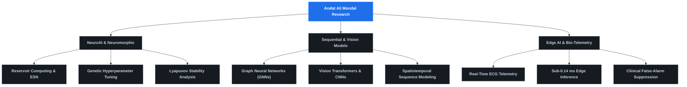

# Mr. Arafat Ali Mondal
### Assistant Professor of Computer Science & Engineering | NeuroAI & Neuromorphic Computing Researcher

 

> *NeuroAI • Reservoir Computing • Neuroevolution & Genetic Algorithms • Brain-Inspired AI for Healthcare • Neuromorphic Computing.*

---

### Academic & Research Experinces

* **Assistant Professor** — Department of Computer Science & Engineering, **Swami Vivekananda University (SVU)**, Barrackpore, Kolkata, India Dec 2025 – Present. 
* **Remote Research Researcher** — **Indian Institute of Technology (IIT) Roorkee**, Neuromimetic Computing Lab *(Focus: Neuromorphic architectures, nano-system architectures, and computational nanotechnology),Sept 2025 – Present (Remote).
* **Research & Development** — National Council of Science Museums, CRTL, Kolkata, Computer Sciences Division, Feb 2024 – Feb 2025.
* **Faculty (Part-time)** — ACES Infotech Private Limited, Kolkata,Jul 2025 – Nov 2026.

---

### Education

* **M.Tech. in Artificial Intelligence** *(2024)*  
  *Maulana Abul Kalam Azad University of Technology (MAKAUT)*, West Bengal, India.  
  *Specialization:* NeuroAI, Evolutionary Optimization, and Sequential Deep Learning.
* **B.Tech. in Electrical Engineering**  
  *Maulana Abul Kalam Azad University of Technology (MAKAUT)*, West Bengal, India.

---

###  Research & Methodology

 

<table>
  <tr>
    <td width="33%" valign="top">
      <h4> NeuroAI & Reservoirs</h4>
      <ul>
        <li><b>Neuro-Evolutionary Reservoir Computing (NERC):</b> Eliminating ESN hyperparameter fragility via validation-guided continuous genetic search.</li>
        <li><b>Dynamical Contractivity:</b> Mathematical verification of the Echo State Property (ESP) via negative Lyapunov exponents (λmax &lt; −0.32, 100% contracting states).</li>
      </ul>
    </td>
    <td width="33%" valign="top">
      <h4> Biomedical Edge Telemetry</h4>
      <ul>
        <li><b>Label-Free Anomaly Detection:</b> Unsupervised next-beat forecasting residuals for beat-level arrhythmia detection.</li>
        <li><b>Alarm Fatigue Suppression:</b> Suppressing clinical false alarms from <b>340+ alarms/hour</b> (persistence) down to <b>&lt;4 alarms/hour</b> with 98–100% precision.</li>
        <li><b>Hard Real-Time Latency:</b> Sub-<b>0.14 ms</b> per-beat inference (&lt;0.05% of cardiac cycle) on micro-watt embedded hardware.</li>
      </ul>
    </td>
    <td width="33%" valign="top">
      <h4>Vision & Spatial Systems</h4>
      <ul>
        <li><b>Agricultural AI:</b> Dual Graph Neural Network (GNN) and Vision Transformer (ViT) architectures for high-throughput fruit grading and quality classification.</li>
        <li><b>Spatial Exploration:</b> Interactive museum display and content recommendation systems.</li>
      </ul>
    </td>
  </tr>
</table>

---

### Research Projects
1.  **Neuro-Evolutionary Reservoir Computing (NERC) for Real-Time ECG Signal Prediction and Brain-Inspired Arrhythmia Detection** *(Ongoing)*
    Objective: Developing ultra-efficient, brain-inspired AI models for real-time ECG prediction and automated arrhythmia detection, suitable for low-power wearable health-monitoring hardware.
2. **Genetically Tuned Reservoir Computing for Next-Beat ECG Forecasting and Label-Free Anomaly Detection: A Negative-Findings Benchmark Against Simple Sequence Baselines***(Ongoing)*
   Objective: Methodological benchmark comparing GA-tuned reservoirs against multi-lag ridge and moving averages under strict patient-isolated splits (MIT-BIH).
3. **Genetic-Algorithm-Tuned Dendritic Reservoir Computing for Next-Beat ECG Prediction and Label-Free Beat Anomaly Detection** *(Ongoing)*
   Objective: Systematic ablation evaluating bio-inspired dendritic state updates and multiplicative gating mechanisms in Echo State Networks.
   *Advisors:* **Dr. Ankush Kumar** *(IIT Roorkee)* and **Dr. Payal Bose** *(SVU, Barrackpore)*.

---

### Publications & Book Chapters
1.  **A Review of Neuroscience-Inspired Deep Learning and Genetic Algorithms** *(2026)*  
   **Mondal, A.A.**, Kumar, A. & Bhattacharyya, N.  
   *BMC Artificial Intelligence* (Springer Nature), 2, 5 (2026).  
   [DOI: 10.1186/s44398-025-00019-0](https://doi.org/10.1186/s44398-025-00019-0)
2.  **Advanced Apple Sorting and Quality Grading Application Using Graph Neural Networks, Vision Transformers, and Convolutional Neural Networks** *(2025)*  
   **Mondal, A.A.**, Bhattacharyya, N. & Ghosh, S.  
   *2025 7th International Symposium on Advanced Electrical and Communication Technologies (IEEE ISAECT)*, Mohali, Punjab, India, pp. 1–8.  
    [IEEE Xplore DOI: 10.1109/ISAECT68904.2025.11318674](https://doi.org/10.1109/ISAECT68904.2025.11318674)
3.  **A Low-Cost AI-Based Apple Quality Grading System Using Contour Analysis and Deep Learning for Real-Time Agricultural Applications** *(2026)*  
   **Mondal, A.A.**, Bose, P. & Mahata, R.  
   *Proceedings of the 3rd International Conference on Computing and Machine Learning (CML 2026)*, Sikkim Manipal University, India, March 2026 *(Presentation Completed)*.
4.  **A Novel Method for Breast Cancer Detection Using KNN** *(2025)*  
   **Mondal, A.A.**, Bhattacharyya, N. & Mondal, S.  
   *YMER*, vol. 24, no. 1, pp. 807–813, Jan. 2025.  
    [PDF Link](https://ymerdigital.com/uploads/YMER240189.pdf)
5. **Interactive Display System for Spatial Content Exploration in Museums** *(2024)*  
   Ghosh, S., **Mondal, A.A.**, Kumar, A., Grove, K., Chatterjee, A. & Bagchi, M.  
   *2024 First International Conference on Intelligent Computing for Emerging and Converging Technologies (IEEE ICICEC)*, Davangere, India, pp. 1–6.  
    [IEEE Conference Link](https://icicec.com/)
6. **Personalized Content Delivery Systems: An AI-Based Age Estimation Approach** *(2025)*  
   **Mondal, A.A.**, Chatterjee, A., Ghosh, S. & Bagchi, M.  
   *Proc. Int. Conf. on Recent Advances in Electrical and Computer Technologies*, CRC Press (Taylor & Francis Group), 2025 *(Presentation)*.
7.  **A Review Paper on Increasing Efficiency of Solar Cells Using Artificial Intelligence and Nanotechnology** *(2023)*  
   Ghosh, S., **Mondal, A.A.** & Guha, P.  
   *International Journal of Research and Analytical Reviews (IJRAR)*, 10(1), pp. 433–435.  
    [View Full Paper](https://ijrar.org/viewfull.php?&p_id=IJRAR23A2791)
8.  **Design and Analysis of P&O Algorithm-Based MPPT Solar System in PSIM** *(2022)*  
   Roy, S.K., Ghosh, S., Chattropadyaya, A., Banerjee, P., Baidya, T., Mondal, T., **Mondal, A.A.** & Bhattacharya, S.  
   *YMER*, 21(6).  
    [PDF Link](https://ymerdigital.com/uploads/YMER2106H9.pdf)
9. **Smart Contracts and Autonomous Decision Frameworks** *(2026),Book Chapters*  
  *Blockchain Foundations For Secure Intelligent Ecosystems* (Pub. Date: 2026-10-04).  
  *Contribution:* Methodology, Writing – original draft.  
   [View Chapter / Book Details](https://www.swamivivekanandauniversity.ac.in/page/book/department-of-computer-science-engineering/blockchain-foundations-for-secure-intelligent-ecosystems/)

---

###  Technical Expertise

| Category | Skills, Frameworks & Tooling |
| :--- | :--- |
| **Programming Languages** | Python, R, C/C++, MATLAB, Bash, SQL, LaTeX |
| **Deep Learning & ML** | PyTorch, TensorFlow, Scikit-Learn, Keras |
| **Data & Signal Analysis** | NumPy, Pandas, Matplotlib, SciPy, Signal Processing, WFDB (PhysioNet) |
| **Computer Vision** | OpenCV, Contour Analysis, Image Segmentation, Object Detection, ImageJ |

---

### Seminars & Academic Workshops
* **Brain Signals for Biometrics and Brain-Computer Interface (BCI)** — Kolkata *(Online)*.  
  *Speaker:* **Dr. Rig Das**, Assistant Professor, University of Wisconsin–La Crosse (UWL), USA.
* **AI and Pattern Recognition** — Kolkata.  
  *Speaker:* **Dr. Sankar Kumar Pal**, President, Indian Statistical Institute (ISI).
* **Convergence of IoT and AI for Emerging Applications** — Computer Society of India (CSI), Kolkata Chapter.  
  *Speaker:* **Prof. Nabarun Bhattacharyya**, Former Senior Director, C-DAC, Kolkata.
---

### Live GitHub Analytics & Activity

 

---

### Contact With Me

* **Institution:** Department of Computer Science & Engineering, Swami Vivekananda University, Barrackpore, Kolkata 700121, India.
* **ORCID Identifier:** [0009-0006-2487-8565](https://orcid.org/0009-0006-2487-8565)
* **ResearchGate:** [Arafat-Mondal](https://www.researchgate.net/profile/Arafat-Mondal)
